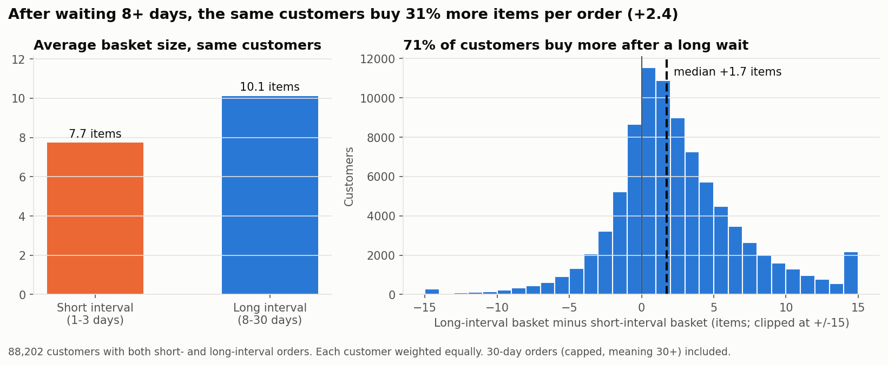
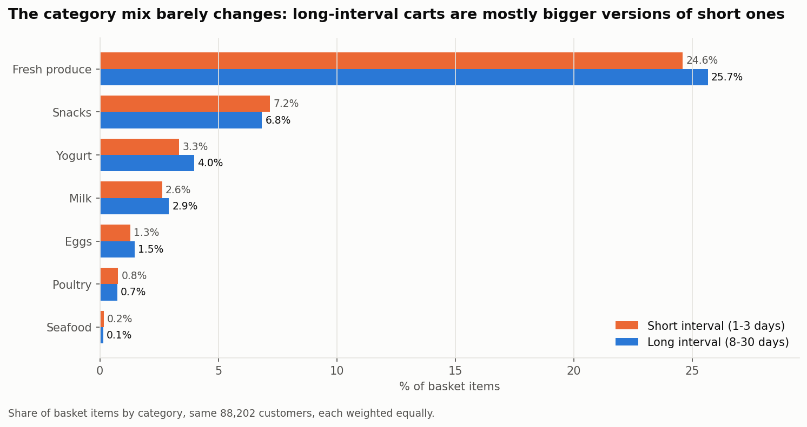
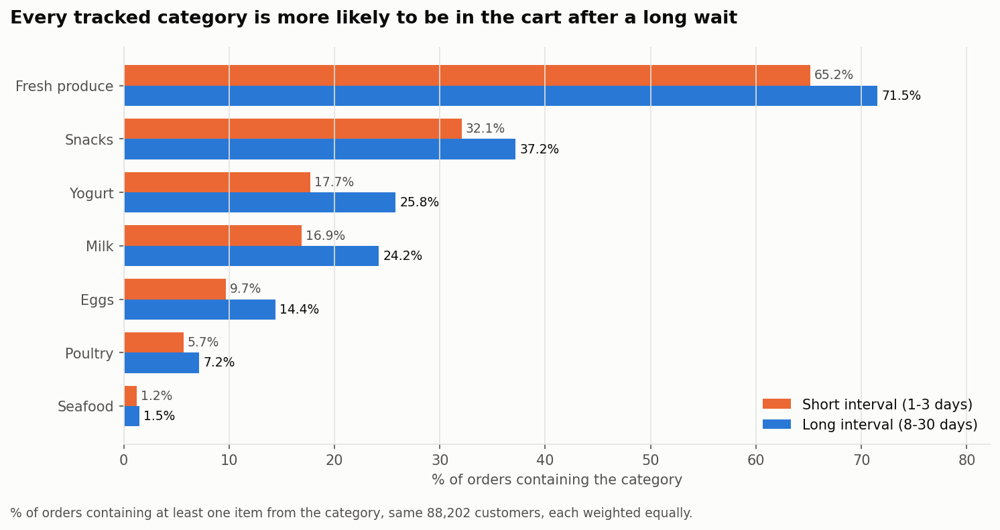
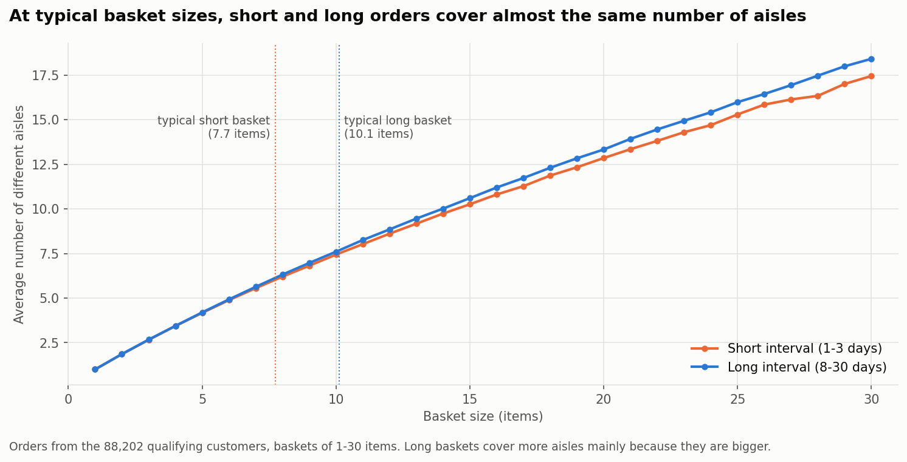
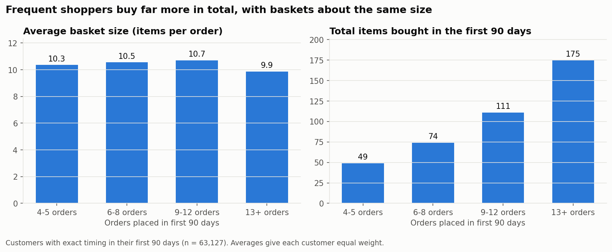

# Grocery Shopping Frequency & Purchasing Patterns: An Instacart Analysis

**Does a customer's shopping cart change when they wait longer between grocery orders?**

Using 3.3 million Instacart orders with known basket contents, I compared each customer's orders placed shortly after their previous one with orders placed after a longer gap.

**Main finding:** shopping frequency is linked much more to *how much* customers buy than to *what* they buy. After waiting longer, the same customers fill noticeably bigger baskets, but the mix of categories in those baskets stays largely the same.

**Tools:** PostgreSQL · Python (pandas, matplotlib) · Jupyter

---

## Key findings

| | Short interval<br>(1–3 days) | Long interval<br>(8–30 days) | Difference |
|---|---|---|---|
| Average basket size | 7.7 items | 10.1 items | **+2.4 items (31% larger)** |
| Different aisles per basket | 5.8 | 7.3 | +1.5 |
| Fresh produce, share of items | 24.6% | 25.7% | +1.1 pts |
| Snacks, share of items | 7.2% | 6.8% | −0.3 pts |

*88,202 customers who placed both short- and long-interval orders. Each customer is compared with themselves, and every customer counts equally. 71% of these customers had bigger baskets after a long wait.*

1. **Baskets are 31% bigger after a long wait.** The same customers average 7.7 items when they reorder within 1–3 days and 10.1 items after waiting 8–30 days. The median customer adds 1.7 items.
2. **The category mix barely changes.** For every category tracked, the share of the basket moves by about one percentage point or less. Produce, yogurt, milk and eggs gain slightly; snacks dip slightly.
3. **More categories show up mainly because the basket is bigger.** Every tracked category appears in more long-interval orders (for example, yogurt goes from 17.7% to 25.8% of orders). But at the same basket size, short and long orders cover almost the same number of aisles.
4. **Supporting context:** across *different* customers, the most frequent shoppers bought about 3.6× as many items in their first 90 days as the least frequent (175 vs 49). Their average basket sizes were similar, about 10 items.



---

## Why compare each customer with themselves?

Comparing all orders together is misleading. Short-interval orders average fewer items overall, but they come mostly from one kind of customer: the most active 25% of customers place 85% of all short-interval orders. Comparing them with everyone's long-interval orders mixes up two questions: *what kind of customer is this* and *what happens when they wait longer*.

So I compared **each customer with themselves**:

1. Keep customers who have at least one **short-interval** order (1–3 days since their previous order) and at least one **long-interval** order (8–30 days).
2. For each customer, calculate their average basket size, category shares and aisle count separately for short and long orders.
3. Average those per-customer results, so each of the 88,202 customers counts equally, however many orders they placed.

This keeps the customer the same and changes only the time since their last order.

---

## Results

### 1. Basket size

The same customers buy **2.4 more items (31%)** when they wait 8+ days. 71% of customers follow this pattern, and 27% go the other way. The result didn't change when I required at least two orders in each group, or when I removed orders with a capped "30+ days" gap.

### 2. Category composition



Long-interval baskets are mostly **bigger versions of the usual cart**. Everyday staples take up a slightly larger share (produce +1.1 pts, yogurt +0.6, milk +0.3, eggs +0.2) and snacks a slightly smaller one (−0.3 pts). For most categories, the median customer shows no change at all.

### 3. Category presence and basket variety



Every tracked category is more likely to be in the cart after a long wait, with the biggest jumps in yogurt (+8.1 pts), milk (+7.3) and fresh produce (+6.4). That fits with bigger baskets: more items means more chances to include each category.



Long-interval baskets cover 1.5 more aisles on average. Comparing baskets **of the same size**, though, the number of aisles is almost identical up to about 10 items, where most orders fall. Only in larger baskets (15+ items) do long-interval orders reach slightly more aisles.

### 4. Supporting context: frequency and total volume



To compare *different* customers fairly, I looked at the same period for everyone: their first 90 days in the data. Customers who placed 13+ orders in that period bought 175 items on average, against 49 for those placing 4–5 orders. Basket sizes were similar across groups (9.9–10.7 items), so total volume follows **how often** people shop, not how much they buy each time.

---

## What this could mean for a grocery retailer

These are observed patterns, not proven cause and effect, so I'd treat them as ideas to test rather than conclusions:

- **Days since last order is a simple, useful signal.** A customer returning after a week or more is likely to place a noticeably bigger order. That could help with picking and delivery capacity planning, or with deciding when a basket-building offer is worth showing.
- **Returning customers mostly want their usual items.** The category mix stays stable, so a "buy it again" list built from a customer's own history probably fits a long-gap order better than promoting new categories.
- **Staples are worth a reminder after a gap.** Milk, yogurt, eggs and produce show the biggest increase in how often they appear after a long wait, which makes them natural candidates for "running low?" reminders.
- **Frequency drives total volume.** Customers who order more often buy far more in total, while their basket size stays about the same. Programs that make regular ordering easier (such as delivery memberships) may matter more than trying to grow each basket. This would need an experiment to confirm.

---

## Data source

This project uses **The Instacart Online Grocery Shopping Dataset 2017**, which contains over 3.4 million anonymized grocery orders from 206,209 customers.

Instacart released the dataset for non-commercial use, and it is available through [Kaggle](https://www.kaggle.com/c/instacart-market-basket-analysis).

The original data files are **not** included in this repository. To rebuild everything from scratch, download the dataset from the source and follow the [instructions below](#reproduce-it).

So that the notebook runs directly from GitHub, `data/processed/` includes the summary tables produced by the SQL scripts. They contain:
- one row per customer of summary metrics (such as average basket size and category shares), plus a few aggregate tables
- no customer IDs, order IDs, product IDs, individual orders or raw transactions
- only the columns the notebook uses

**Limitations:** customer histories are incomplete, intervals of 30 days or more are capped at 30, and the data has no product prices or purchase quantities.

**Attribution:** "The Instacart Online Grocery Shopping Dataset 2017", published by Instacart. The data and the summary tables derived from it remain subject to Instacart's terms for non-commercial use.

## Analysis scope and limitations

**What was excluded:**

| Excluded | Why |
|---|---|
| 75,000 "test" orders | Basket contents aren't included in the public data |
| First orders | No previous order, so no interval |
| Same-day reorders (0 days) | They look like add-on orders, averaging just 7 items |
| 4–7 day orders | Left out so the short and long groups are clearly separated |

**Limitations to keep in mind:**

- **Association, not causation.** The data shows *what* changes, not *why*. A big stock-up order may be what causes the longer gap, rather than the other way round. Trip purpose, household size and promotions aren't in the data.
- **Gaps are capped at 30 days.** A recorded "30" means "30 or more", so the long group mixes 8-day gaps with multi-month ones, and customers who shop less than monthly can't be identified. Removing capped orders didn't change the basket-size result.
- **Partial histories, no dates.** Each customer has 4–100 orders and the data has no calendar dates, so seasonality can't be studied.
- **Items, not spend.** There are no prices or quantities: an "item" is one product line in the cart.
- **Who is covered.** The within-customer comparison includes the 43% of customers who placed both short- and long-interval orders, which leans towards more frequent shoppers. Seafood and poultry make up less than 1% of items, so their numbers are less reliable.

---

## How the analysis works

| Step | File | What it does |
|---|---|---|
| 1 | [`sql/01_create_and_load.sql`](sql/01_create_and_load.sql) | Creates the tables and loads the raw CSV files |
| 2 | [`sql/02_data_profiling.sql`](sql/02_data_profiling.sql) | Data-quality checks: row counts, missing values, duplicates, interval distribution |
| 3 | [`sql/03_build_order_baskets.sql`](sql/03_build_order_baskets.sql) | One row per order: item count, aisle count, items per category |
| 4 | [`sql/04_q1_frequency_vs_volume.sql`](sql/04_q1_frequency_vs_volume.sql) | Each customer's first 90 days (supporting analysis) |
| 5 | [`sql/05_q2_q4_within_customer.sql`](sql/05_q2_q4_within_customer.sql) | Each customer's short vs long orders, plus sensitivity checks |
| 6 | [`notebooks/instacart_analysis.ipynb`](notebooks/instacart_analysis.ipynb) | Final metrics, charts and checks in pandas and matplotlib |

PostgreSQL does the heavy lifting: joins, grouping and filtering across 33.8 million basket rows. It exports smaller customer-level tables to `data/processed/`, and the notebook works from those.

**Category definitions** (Instacart's own aisles; organic and non-organic are combined):
Fresh produce = fresh fruits, fresh vegetables, packaged vegetables & fruits · Snacks = all 7 snacks-department aisles · Poultry = poultry counter, packaged poultry · Seafood = seafood counter, packaged seafood · Eggs, Milk, Yogurt = their own aisles.

### Reproduce it

```bash
# 1. Download archive.zip from Kaggle and extract it into data/raw/
unzip archive.zip -d data/raw

# 2. Build the database and run the SQL scripts (from the project root)
createdb instacart
mkdir -p data/processed
for f in sql/0*.sql; do psql -d instacart -f "$f"; done

# 3. Run the notebook
pip install -r requirements.txt
jupyter notebook notebooks/instacart_analysis.ipynb
```

The summary tables in `data/processed/` are already included, so you can run the notebook (step 3) without steps 1–2. Steps 1–2 rebuild those tables from the original data and take a few minutes on a laptop.

## Repository structure

```
├── README.md
├── SUMMARY.md                  # one-page business summary
├── LICENSE                     # MIT, covers the code only
├── requirements.txt
├── sql/                        # numbered PostgreSQL scripts
├── notebooks/
│   └── instacart_analysis.ipynb
├── data/
│   ├── raw/                    # original CSVs (not included; download from Kaggle)
│   └── processed/              # summary tables exported from SQL (no IDs or raw transactions)
└── charts/                     # figures used in this README
```

## License

The original code in this repository (SQL scripts and notebook code) is released under the [MIT License](LICENSE). The license does **not** cover the Instacart dataset or the data tables derived from it, which remain subject to Instacart's terms.
